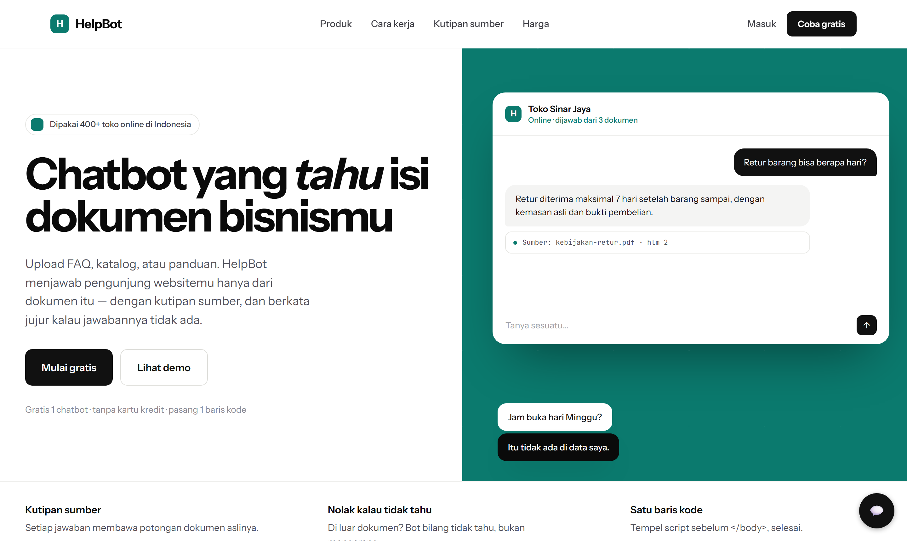
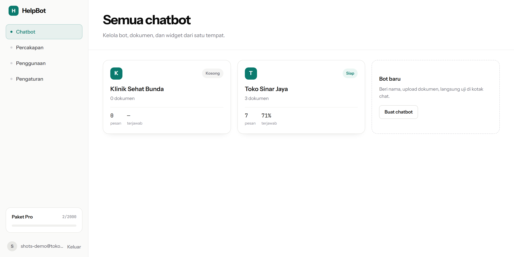
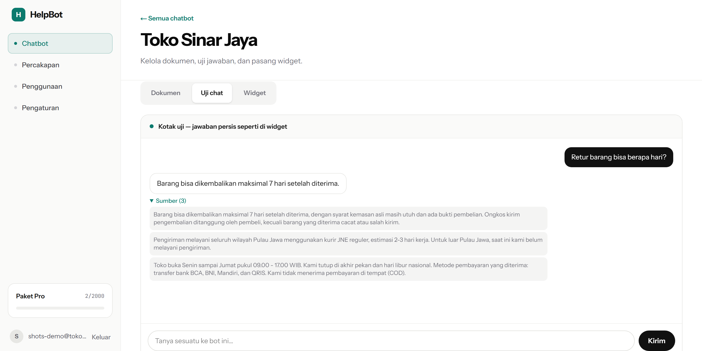
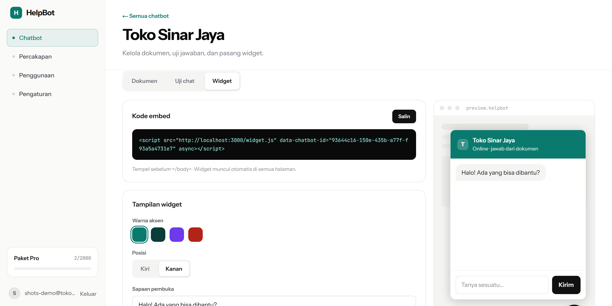
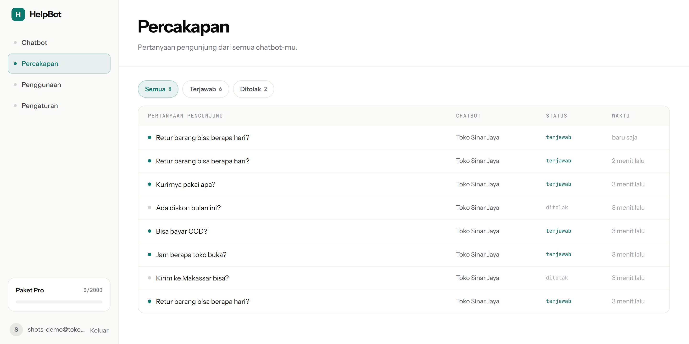
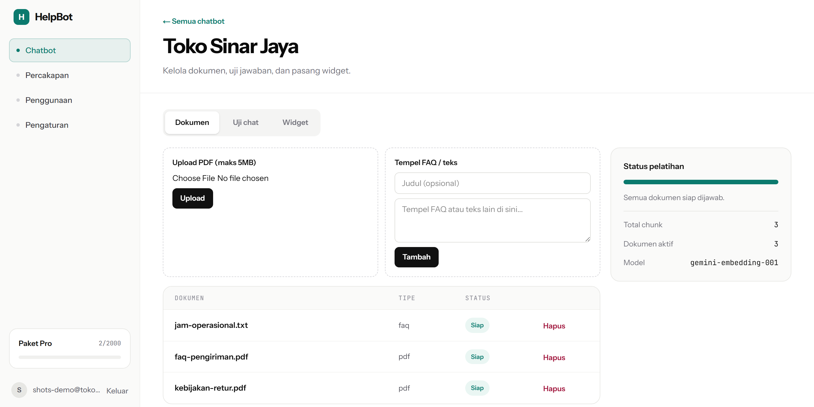
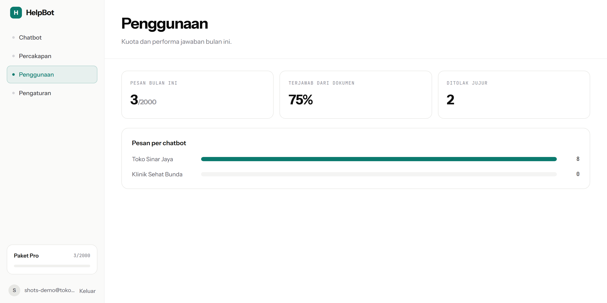
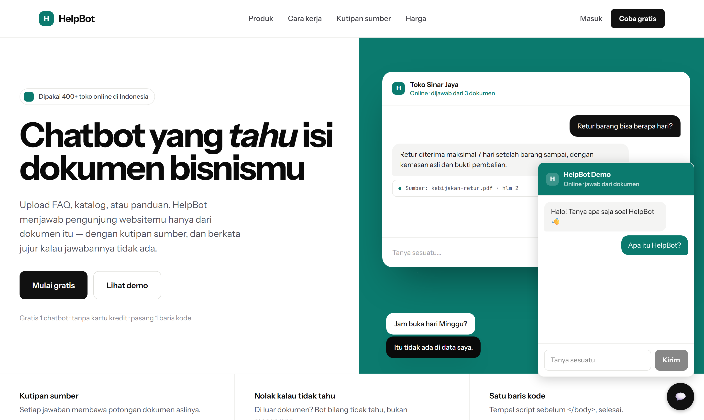
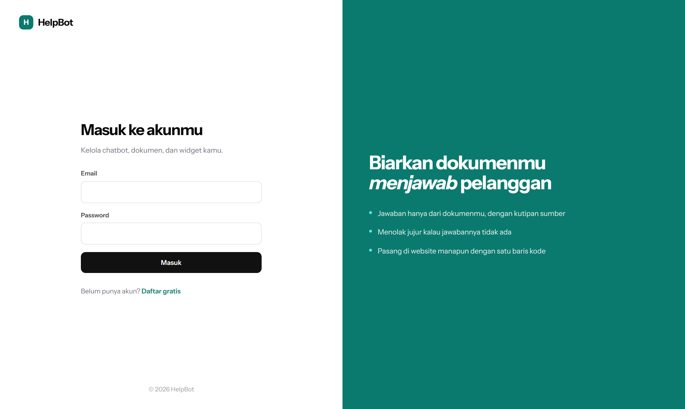
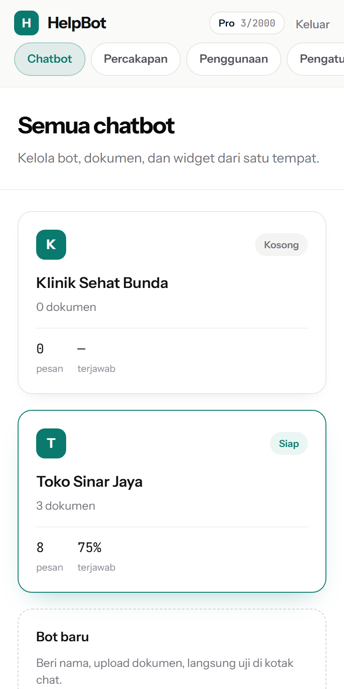

# HelpBot

Bikin chatbot customer service dari dokumen bisnismu sendiri, tanpa coding.
Upload FAQ atau katalog, lalu tempel satu baris `<script>` di website.
Bot menjawab hanya dari dokumen itu, menyertakan kutipan sumbernya, dan
bilang tidak tahu kalau memang tidak ada jawabannya.

**[Coba demonya →](https://helpbot-xi.vercel.app)** (klik bubble chat di
pojok kanan bawah, tidak perlu daftar)



---

## Masalah yang diselesaikan

Toko online kecil dapat pertanyaan yang itu-itu saja: jam buka, ongkir,
cara retur, bisa COD tidak. Menjawabnya satu per satu di WhatsApp sepanjang
hari jelas tidak masuk akal, tapi menyewa CS 24 jam juga terlalu mahal.

Chatbot generik tidak menyelesaikan ini, karena dia tidak tahu kebijakan
retur tokomu. Yang dibutuhkan adalah bot yang membaca dokumenmu.

## Cara kerjanya

Dokumen yang diupload dipecah jadi potongan kecil, diubah jadi vektor
lewat Gemini, lalu disimpan di Postgres (pgvector). Saat pengunjung
bertanya, pertanyaannya ikut diubah jadi vektor, dicocokkan dengan
potongan yang paling mirip, dan hanya potongan itulah yang diberikan ke
model bahasa sebagai bahan menjawab.

```
Pengunjung ─▶ widget.js ─▶ /api/public-chat ─┐
                                              ├─▶ embed pertanyaan (Gemini)
Pemilik bot ─▶ Dashboard ─▶ /api/chat ────────┘             │
                                                            ▼
                                              match_chunks() — cosine search
                                              pgvector, dikunci ke 1 chatbot
                                                            │
                                                            ▼
                                              susun konteks + system prompt
                                                            │
                                                            ▼
                                              Gemini Flash ─▶ jawaban + sumber
```

Pipeline saat upload dokumen:

```
PDF / teks / FAQ ─▶ ekstrak teks (unpdf) ─▶ potong per paragraf & kalimat
                 ─▶ embed batch (gemini-embedding-001, 1536 dimensi)
                 ─▶ simpan ke tabel chunks ─▶ status: processing → ready
```

## Tampilan

Dashboard untuk mengelola semua bot, dokumen, dan kode widget:



Setiap jawaban di kotak uji membawa potongan dokumen aslinya, jadi kamu
bisa langsung cek jawabannya benar-benar bersumber dari mana:



Widget bisa diatur warna, posisi, dan sapaannya. Panel kanan bukan mockup:
itu `widget.js` yang asli, jalan di dalam iframe dengan pengaturan yang
baru disimpan, jadi yang kamu lihat persis seperti yang muncul di website
pelanggan.



Semua pertanyaan yang masuk terekam, termasuk yang ditolak bot. Yang
ditolak justru berguna: itu daftar hal yang belum ada di dokumenmu.



<details>
<summary>Tampilan lainnya</summary>

Kelola dokumen dan pantau status pemrosesannya:



Pemakaian kuota bulanan dan performa jawaban per bot:



Widget yang sudah terpasang di sebuah website:



Halaman masuk, dan tampilan dashboard di layar HP:

<p>
  
  
</p>

</details>

## Tech stack

| Bagian | Pakai apa | Kenapa |
| --- | --- | --- |
| Frontend + API | Next.js 15 (App Router), TypeScript, Tailwind | Satu framework untuk UI, Server Actions, dan API route |
| Database, auth, vektor | Supabase (Postgres + pgvector) | Tiga kebutuhan dalam satu layanan, plus RLS bawaan Postgres |
| Embedding + LLM | Gemini (`gemini-embedding-001`, `gemini-3.1-flash-lite`) | Ada free tier tanpa kartu kredit |
| Pembayaran | Midtrans Snap (sandbox) | Gateway lokal, dukung transfer bank dan QRIS |
| Widget | Vanilla JS, tanpa dependency | Tidak bentrok dengan CSS atau JS website yang memasangnya |
| Deploy | Vercel + Supabase Cloud | |

## Isolasi antar pengguna

Ini aplikasi multi-tenant, jadi bot milik A tidak boleh bisa membaca
dokumen milik B. Penjaganya ada di dua tempat:

**Row Level Security di semua tabel.** `chatbots`, `documents`, `chunks`,
`conversations`, `messages`, `usage`, dan `billing_orders` semuanya
mengaktifkan RLS. Kalaupun ada bug di kode aplikasi yang lupa memfilter
`user_id`, database tetap menolak.

**Endpoint publik ditangani berbeda.** Widget dipakai pengunjung anonim
yang tidak punya sesi Supabase, jadi RLS tidak bisa dipakai di sana.
Solusinya bukan membuka RLS untuk role `anon` — kalau itu dilakukan,
siapa pun yang membaca anon key dari widget (dan key itu memang publik)
bisa query tabel `chunks` langsung lewat REST API Supabase dan melihat
data semua tenant. Yang dipakai adalah service-role client yang kuncinya
tidak pernah keluar dari server, dan kode aplikasi memfilter `chatbot_id`
secara eksplisit di setiap query.

## Menahan biaya API

- Konteks ke LLM dibatasi ~6.000 karakter, output 500 token, temperature
  0.2.
- Kalau tidak ada potongan dokumen yang cukup mirip, bot langsung menjawab
  "tidak ada di data saya" tanpa memanggil LLM sama sekali. Bot yang belum
  diisi dokumen tidak membakar kuota.
- Rate limit dua lapis di endpoint publik: 10 pesan per 5 menit per
  pengunjung, dan 30 pesan per 5 menit per IP. Lapis kedua menangkap
  pengunjung yang menghapus localStorage untuk mereset lapis pertama.
- Kuota bulanan per paket dicek sebelum memanggil LLM, dan baru dihitung
  setelah jawaban berhasil. Request yang gagal tidak memotong kuota.

## Evaluasi

Grounding gampang diklaim tapi susah dibuktikan, jadi ada skrip yang
mengukurnya: [`eval/run.ts`](eval/run.ts) membuat bot sementara dari
dokumen contoh, menanyakan 14 pertanyaan lewat pipeline sungguhan
(Supabase + Gemini, bukan mock), lalu menghitung skornya. Jalankan ulang
dengan `npm run eval`; rincian per pertanyaan ada di
[`eval/results.md`](eval/results.md).

| Metrik | Hasil | Artinya |
| --- | --- | --- |
| Hit rate retrieval | **100%** (9 pertanyaan) | Potongan dokumen yang memuat jawabannya benar-benar terambil |
| Faithfulness | **100%** (9 pertanyaan) | Jawaban memang memakai fakta dari potongan yang terambil |
| Konsistensi penolakan | **100%** (5 pertanyaan) | Pertanyaan di luar dokumen selalu ditolak dengan kalimat yang sama |

## Batasan yang diketahui

- **Kuota gratis Gemini beda-beda per model.** Ketahuan saat menjalankan
  skrip evaluasi: alias `gemini-flash-latest` waktu itu mengarah ke model
  yang jatah gratisnya cuma 20 request per hari. Karena itu model generasi
  dipatok ke `gemini-3.1-flash-lite`, bukan alias, supaya tidak diam-diam
  pindah ke model berkuota kecil.
- **Rate limit publik masih bisa ditembus** pengunjung yang niat menghapus
  localStorage sekaligus ganti IP. Dua lapis itu menyulitkan, bukan
  menutup rapat.
- **Pembayaran Midtrans di sini sekali bayar, bukan langganan berulang.**
  Tidak ada downgrade otomatis karena memang tidak ada siklus langganan.
  Cukup untuk membuktikan alur upgrade jalan, belum untuk billing
  sungguhan.
- **Ambang similarity 0.3 belum di-tuning** dari data besar. Yang benar-benar
  menahan bot mengarang tetap instruksi grounding di system prompt, bukan
  angka ini.
- **Free tier Gemini boleh memakai input untuk melatih model Google.**
  Aman untuk demo dengan data contoh, tapi kalau dipakai pelanggan
  sungguhan perlu pindah ke tier berbayar.

## Menjalankan lokal

```bash
npm install
cp .env.example .env.local   # isi kunci Supabase, Gemini, dan Midtrans
npm run dev
```

Skema database ada di `supabase/migrations/`. Jalankan berurutan dari
`0001` sampai `0006` lewat SQL Editor di dashboard Supabase.

```bash
npm run lint       # ESLint
npm run test       # Vitest, unit test chunking / retrieval / billing
npm run eval       # evaluasi RAG end-to-end (memakai kuota API sungguhan)
npm run seed:demo  # buat chatbot demo untuk landing page
```

## Struktur

```
src/lib/ingest/       ekstraksi PDF, chunking, orkestrasi proses dokumen
src/lib/gemini/       wrapper embedding dan generation
src/lib/chat/         retrieval, prompt, penyusun jawaban
src/lib/billing/      batas paket dan pelacakan kuota bulanan
src/lib/dashboard/    agregasi statistik untuk halaman dashboard
src/lib/midtrans/     client Snap API dan verifikasi signature webhook
src/lib/supabase/     client browser, server, dan service-role
src/app/_landing/     komponen landing page
src/app/dashboard/    UI pemilik bot: daftar, dokumen, uji chat, widget,
                      percakapan, penggunaan, pengaturan
src/app/api/          route chat (privat & publik) dan webhook Midtrans
public/widget.js      widget embeddable, vanilla JS tanpa dependency
eval/                 dataset dan skrip evaluasi RAG
scripts/              seeder chatbot demo
supabase/migrations/  skema database dan policy RLS
```

Spesifikasi produk lengkap ada di [PRD.md](PRD.md), urutan pembangunannya
di [plan.md](plan.md).
